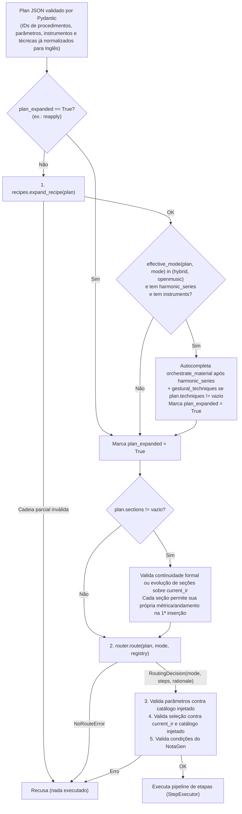
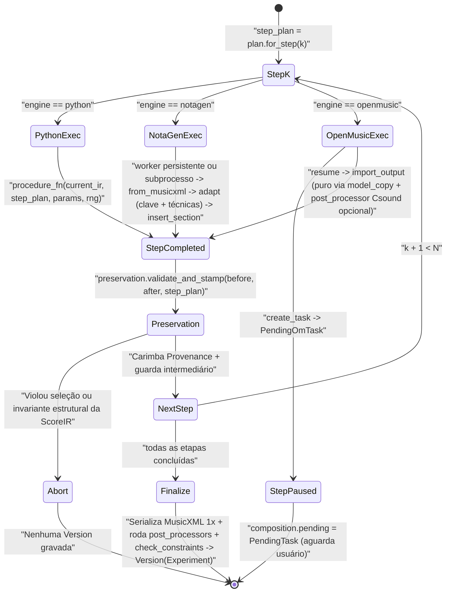

# Documentação de Fluxo de Processo — Composição Musical (`v2` Refatorada em Inglês)

> **Escopo:** Arquitetura da camada de composição simbólica do Muschat na **v2** e sua padronização integral para Inglês + decomposição modular (Fases 0–4).  
> **Verificação:** Baseada no código-fonte Python/Lisp e execução da suíte (`uv run pytest -q`: **564 passed** após Fase 0 — Expand).

## 1. Visão Geral: `v1` vs. `v2` (Arquitetura Alvo Padronizada em Inglês)

Na **v1**, o Muschat era um assistente de chat com RAG híbrido e geração eventual de exemplos curtos monofônicos em MusicXML/Verovio.

Na **v2**, foi construída toda a **camada de composição simbólica e algorítmica**, centrada em uma representação intermediária imutável ([ScoreIR](../muschat/score_ir.py)) e governada pelo princípio de que **o LLM nunca escreve código nem notas diretamente em pedidos de composição**: ele gera um [Plan](../muschat/plan.py) JSON validado por schema, cujas operações executam procedimentos determinísticos (Python) ou pontes controladas (NotaGen-X / OpenMusic assistido).

Com a refatoração da **v2**:
- **Código, modelos de domínio e prompts internos 100% em Inglês:** todos os módulos, classes, métodos, campos Pydantic, IDs de procedimentos/modos/motores e prompts/delimitadores anti-injeção (`<user_question>`, `<internal_analysis>`, `<excerpt>`) usam Inglês idiomático; a fronteira bilíngue (PT/EN/IT/DE) existe apenas na entrada do usuário (normalizada imediatamente para IDs canônicos em Inglês), na leitura retrocompatível de JSONs legados ([Composition.from_json](../muschat/composition.py)) e na camada de apresentação/resposta.
- **Orquestração desacoplada:** separação entre planejamento (`planning`, com política única de retry para `openmusic`, `hybrid` e `notagen`), preservação/validação estrutural leve em memória (`preservation`), execução uniforme de etapas (`StepCompleted` / `StepPaused`) e pós-processamento Csound desacoplado do parser OpenMusic (`Experiment.audio`).
- **Núcleo musical e notação compartilhados:** módulo espectral/acústico único (`spectrum`), grafia microtonal (`notation/spelling`), iterador único de linha do tempo e quiálteras (`notation/timeline`) para MusicXML e LilyPond, e alinhamento de famílias instrumentais com o RAG via `instruments.identify`.

```mermaid
flowchart LR
    subgraph Entradas["Pontos de Entrada (Fronteira Bilíngue PT/EN)"]
        UI["Chat Streamlit (app.py)"]
        SB["Sidebar: Reapply / Open MusicXML / Resume / Discard"]
        CLI["Referências Batch (muschat/references.py)"]
    end

    subgraph Nucleo["Planejamento, Roteamento e Orquestração (100% Inglês)"]
        REA["reasoning.respond (RAG condicional + janela de histórico)"]
        ORQ["orchestrator (compose / reapply / resume / open_score / discard)"]
        PLN["planning (build_plan + retry unificado + normalize_plan)"]
        ROT["router.route (effective_mode + R1–R6)"]
        REG["registry.Registry (detect_capabilities em cache)"]
    end

    subgraph Motores["Executores de Etapa (StepCompleted / StepPaused)"]
        PY["Python/Abjad (muschat/procedures/ + spectrum)"]
        NG["NotaGen-X Local (notagen.py + worker persistente opcional)"]
        OM["OpenMusic Assistido (openmusic.py + om_patches.py + patches/*.lisp)"]
    end

    subgraph Pos["Preservação, Estado Tipado e Notação Unificada"]
        PRES["preservation (diff_scores + validação estrutural em memória)"]
        REST["constraints.check_constraints + unplayable_techniques"]
        COMP["Composition (Version com Experiment tipado / PendingTask)"]
        TL["notation/timeline + notation/spelling"]
        NOT["MusicXML / Abjad+LilyPond / Verovio / MIDI / Csound Audio / ZIP"]
    end

    UI --> REA
    REA --> ORQ
    SB --> ORQ
    CLI --> ORQ
    ORQ --> PLN --> ROT
    REG --> ROT
    ROT --> PY
    ROT --> NG
    ROT --> OM
    PY --> PRES
    NG --> PRES
    OM --> PRES
    PRES --> REST --> COMP --> TL --> NOT
```



---

## 2. Mapa de Módulos (Como Fica a Estrutura Padronizada)

| Camada | Módulo Canônico (Inglês) | Legado (`v2` pré-Fase 0) | Responsabilidade Principal |
|---|---|---|---|
| **Interface** | [app.py](../app.py) | `app.py` | Sessão Streamlit, cache de capacidades (`detect_capabilities`) e de artefatos renderizados por versão/transposição, controles de composição e exportação. |
| **Turno de Chat** | `muschat/reasoning.py`, `muschat/prompts.py`, [muschat/security.py](../muschat/security.py) | `reasoning.py`, `prompts.py`, `seguranca.py` | Sanitização (`sanitize`), análise estruturada (`analyze`), RAG condicional (pulado quando `intent == "compose"`), janela de histórico conversacional, prompts e delimitadores 100% em Inglês (`<user_question>`, `<internal_analysis>`, `<excerpt>`). |
| **Orquestração** | `muschat/orchestrator.py` | `orquestrador.py` | Fachada enxuta (`compose`, `reapply`, `resume`, `open_score`, `discard`) e loop sequencial sobre `StepCompleted` / `StepPaused` + execução de `post_processors`. |
| **Planejamento** | `muschat/planning.py`, `muschat/recipes.py` | `_planejar`/`_aplicar` em `orquestrador.py`, `receitas.py` | Montagem do catálogo no prompt, invocação do gerador com retry unificado (`openmusic`, `hybrid`, `notagen`), expansão de receitas (`expand_recipe`), autocompletar híbrido e evolução formal entre turnos. |
| **Preservação** | `muschat/preservation.py` | `_conferir` em `orquestrador.py` | Conferência de seleção (`diff_scores`), carimbo de `Provenance` e validação estrutural leve em memória por etapa (deixando a serialização MusicXML completa apenas para o resultado consolidado). |
| **Schema & Estado** | [muschat/plan.py](../muschat/plan.py), [muschat/composition.py](../muschat/composition.py) | `plano.py`, `composicao.py` | `Plan`, `Operation`, `Parameter`, `Selection`, `Section`; histórico append-only `Composition` (`Version` com `Experiment` Pydantic tipado, `PendingTask`, `OmTask`) e adaptador retrocompatível `Composition.from_json`. |
| **Modelo Musical** | [muschat/score_ir.py](../muschat/score_ir.py) | `musicir.py` | IR imutável em frações exatas (`Fraction`) e `midicents`: `ScoreIR`, `Part`, `Voice`, `Tuplet`, `Measure`, `Note`, `Rest`, `ElectronicEvent`, `Curve`, `SpectralFrame`, `Partial`, `Pitch`, `Provenance`, `diff_scores`, `locate`, `gestures`, `ties_to`. |
| **Capacidades & Roteador** | [muschat/registry.py](../muschat/registry.py), [muschat/router.py](../muschat/router.py) | `registro.py`, `roteador.py` | `Capability`, `Registry`, `detect_capabilities`; `effective_mode(plan, mode)`, `route`, `RoutingDecision`, `Step`, `NoRouteError` implementando `R1`–`R6` ([ADR 0002](./adr/0002-regras-do-roteador.md)). |
| **Domínio & Restrições** | [muschat/instruments.py](../muschat/instruments.py), [muschat/constraints.py](../muschat/constraints.py), [muschat/sections.py](../muschat/sections.py), `muschat/orchestration.py` | `instrumentos.py`, `restricoes.py`, `secoes.py`, `orquestracao.py` | Tabela `INSTRUMENTS` + normalização bilíngue `identify` (compartilhada com o RAG); `Constraint`, `Violation`, `check_constraints`; `insert_section` com suporte a métricas heterogêneas por seção; adaptação idiomática (clave + filtro de técnicas). |
| **Núcleo Espectral & Procedimentos** | `muschat/spectrum.py`, `muschat/procedures/` | `procedimentos/` | Conversões Hz ↔ midicents, quantização microtonal, parciais e dinâmica por compasso compartilhados entre os 20 procedimentos Python e `om_patches.py`. |
| **Motores Externos** | `muschat/notagen.py`, `services/notagen_generate.py`, `muschat/openmusic.py`, `muschat/om_patches.py` | `notagen.py`, `servicos/notagen_gerar.py`, `openmusic.py`, `patches_om.py` | Runner NotaGen-X com worker persistente opcional (`idle_timeout`) e fallback para subprocesso; ponte assistida OpenMusic ([ADR 0001](./adr/0001-integracao-openmusic-assistida.md)) com leitura pura (`model_copy`) e Csound desacoplado em pós-processamento. |
| **Notação & Exportação** | `muschat/notation/timeline.py`, `muschat/notation/spelling.py`, `muschat/notation/musicxml.py`, `muschat/notation/lilypond.py`, `muschat/notation/techniques.py`, `muschat/notation/render.py`, `muschat/export.py` | `notacao/*`, `exportacao.py` | Iterador único de linha do tempo/quiálteras (`timeline`) e grafia espectral (`spelling`) consumidos sem dependência cruzada por MusicXML e LilyPond; Verovio SVG, MIDI SMF1 e pacote `.zip`. |
| **Config & Erros** | [muschat/config.py](../muschat/config.py), [muschat/errors.py](../muschat/errors.py) | `config.py`, `erros.py` | `Config`, `load_config`, `MissingApiKeyError` e `error_message`. |

---

## 3. Fluxos Detalhados da Arquitetura Refatorada

### 3.1 Fluxo Principal via Chat (`reasoning` → `orchestrator` → `planning` / `router` / `preservation`)

```mermaid
sequenceDiagram
    autonumber
    actor U as Compositor (PT/EN)
    participant R as reasoning
    participant G as Gemini API (Prompts EN)
    participant RAG as HybridRetriever
    participant O as orchestrator
    participant P as planning
    participant E as StepExecutor (Py/NG/OM)
    participant V as preservation
    participant C as Composition

    U->>R: mensagem (texto em PT ou EN)
    alt composition.pending != None
        alt texto inicia com número/parêntese/sinal
            R->>O: resume(composition, texto)
            O-->>R: Result (version ou erro)
            R-->>U: Resumo + Partitura (sem chamar Gemini)
        else texto comum
            R-->>U: Aviso de tarefa OM pendente (sem chamar Gemini)
        end
    end

    R->>R: sanitize(mensagem) + janela de histórico
    R->>G: analyze(mensagem_segura, histórico_janelado) -> Analysis JSON
    alt not analysis.in_scope
        R-->>U: prompts.REFUSAL
    end

    alt analysis.notation == "compose"
        Note over R,RAG: Pula busca de embeddings no RAG em turnos de composição!
        R->>O: compose(mensagem_segura, composition, mode, registry, composer)
        O->>P: build_and_normalize_plan(prompt, current_ir, mode, registry, catalog)
        P->>G: generate_content (system=PLAN_PROMPT em Inglês + seções atuais como contexto)
        opt effective_mode in ("openmusic","hybrid","notagen") e omitiu operação obrigatória do motor
            P->>G: retry único com instrução de correção de rota
        end
        P->>P: normalize_plan (se not plan_expanded: expand_recipe + hybrid autocomplete)
        P->>P: route(plan, mode, registry) + valida seleção (no catálogo injetado), faixas e condições
        P-->>O: NormalizedPlan + RoutingDecision + parameters
        O->>E: executa etapas 0..N-1 (StepCompleted | StepPaused)
        alt StepPaused (etapa OpenMusic)
            O->>C: grava composition.pending = PendingTask(...)
            O-->>R: Result(version=None, task=OmTask)
            R-->>U: Instruções da tarefa (sem síntese Gemini)
        else Erro/Violação de preservação em qualquer etapa
            O-->>R: Result(version=None, summary="Operation refused...")
            R-->>U: summary direto (sem síntese Gemini)
        else Todas as etapas StepCompleted
            E-->>V: validate_and_stamp(before, after, step_plan) (em memória, sem XML intermediário)
            O->>O: valida MusicXML final uma única vez + executa post_processors (ex.: Csound -> Experiment.audio)
            O->>C: composition.add(Version com Experiment tipado)
            O-->>R: Result(version=Version, summary)
            R->>G: chat.send_message(system=SYSTEM+TURN_CONTEXT em Inglês + inventário real; responde no idioma do usuário)
            R-->>U: Resposta + Partitura (cacheada por ScoreIR + transposição)
        end
    else analysis.notation in ("none", "corpus", "generate")
        R->>RAG: search(queries, k, instruments normalizados via instruments.identify)
        R->>G: chat.send_message(...)
        R-->>U: Resposta teórica / trecho do acervo / exemplo ilustrativo
    end
```

---

### 3.2 Planejamento, Normalização Idempotente e Roteamento (`planning` & `router`)



#### Mapeamento Canônico de Procedimentos (`muschat/plan.py` & `muschat/procedures/`)

| ID Canônico (Inglês) | ID Legado (`v2` PT) | Motor(es) |
|---|---|---|
| `harmonic_series` | `serie_harmonica` | Python, OpenMusic (`Esquisse`) |
| `orchestrate_material` | `orquestrar_material` | Python |
| `spectralize` | `espectralizar` | Python |
| `detune` | `desafinar` | Python |
| `timbral_substitution` | `substituir_timbre` | Python |
| `rarefy` | `rarefazer` | Python |
| `micropolyphony` | `micropolifonia` | Python |
| `deform_rhythm` | `deformar_ritmo` | Python |
| `transpose`, `invert`, `retrograde`, `rotate`, `scale_intervals` | `transpor`, `inverter`, `retrogradar`, `rotacionar`, `intervalos` | Python |
| `augment_diminish`, `permute_durations`, `subdivide` | `aumentacao_diminuicao`, `permutar_duracoes`, `subdividir` | Python |
| `density`, `progressive_register`, `progressive_dynamics` | `densidade`, `registro_progressivo`, `dinamica_progressiva` | Python |
| `gestural_techniques`, `apply_techniques` | `tecnicas_por_gesto`, `aplicar_tecnicas` | Python |
| `distribute`, `events_from_spectrum` | `distribuir`, `eventos_do_espectro` | Python |
| `generate_notagen` | `gerar_notagen` | NotaGen-X |
| `chaotic_density`, `chaotic_register`, `chaotic_dynamics`, `chaotic_durations` | `densidade_caotica`, `registro_caotico`, `dinamica_caotica`, `duracoes_caoticas` | OpenMusic (`Chaos`) |
| `distribute_by_constraints` | `distribuir_restricoes` | OpenMusic (`Situation`) |
| `pitches_by_constraints` | `alturas_por_restricoes` | OpenMusic (`Cluster-Engine`) |
| `additive_synthesis` | `sintese_aditiva` | OpenMusic (`OMChroma` + `Csound`) |
| `supervp_analysis` | `analise_supervp` | OpenMusic (`OM-SuperVP`) |

---

### 3.3 Contrato de Execução por Etapa (`StepExecutor`) e Preservação (`preservation`)



---

### 3.4 Notação Compartilhada (`notation/timeline` & `notation/spelling`) e Migração de Persistência

1. **Desacoplamento entre MusicXML e LilyPond:**
   - `muschat/spectrum.py` e `muschat/notation/spelling.py` concentram toda a matemática acústica (Hz ↔ midicents, quantização microtonal e escolha enarmônica/quarto-de-tom/oitavo-de-tom).
   - `muschat/notation/timeline.py` resolve a árvore de quiálteras aninhadas (`Tuplet` com `parent`), preenche lacunas com pausas explícitas e rastreia o estado de ligaduras (`ties_to`) e glissandos.
   - `muschat/notation/musicxml.py` e `muschat/notation/lilypond.py` consomem `timeline` e `spelling` de forma independente, sem importação cruzada entre os dois escritores.
2. **Retrocompatibilidade Total de JSON (`Composition.from_json`):**
   - Arquivos `composicao.json` exportados antes da padronização em Inglês (`versoes`, `indice`, `pendente`, `compassos`, `partes`, `vozes`, `eventos`, `quialteras`, `alturas`, `plano`, `decisao`, `semente`, `tarefa` e nomes antigos de procedimentos/parâmetros/modos/instrumentos/técnicas) são convertidos automaticamente na leitura por `migrate_legacy_score_ir_dict`, `migrate_legacy_plan_dict`, `migrate_legacy_experiment_dict` e `PendingTask._migrate_legacy` em [muschat/composition.py](../muschat/composition.py), preservando `Version.reapplicable` e retomada de tarefas OpenMusic.
3. **Ordem de Execução dos Tickets (`.scratch/refatoracao-composicao/issues/`):**
   - **Ticket 01 (`done`):** *Fase 0 (Expand)* — Schemas e modelos centrais em Inglês (`score_ir`, `instruments`, `constraints`, `plan`, `sections`, `registry`, `router`, `composition`, `config`, `errors`, `security`), normalização bilíngue e migração de JSON legado.
   - **Ticket 02:** *Fase 0 (Migrate Batch 1)* — Procedimentos, receitas, OpenMusic, NotaGen, orquestração e peças de referência em Inglês.
   - **Ticket 03:** *Fase 0 (Migrate Batch 2 & Contract)* — Notação, exportação, RAG, prompts/delimitadores LLM em Inglês, `reasoning`, `orchestrator`, `app.py`, remoção de shims em português e lint estático de idioma.
   - **Tickets 04 e 05:** *Fase 1* — `effective_mode` único, catálogo injetado na validação de seleção, `Experiment` tipado com `reapply` idempotente, seções com métricas heterogêneas, evolução formal entre turnos, atribuição idiomática NotaGen e imutabilidade no OpenMusic.
   - **Tickets 06 e 07:** *Fase 2* — Extração de `planning` (retry unificado) e `preservation` (validação leve em memória), `StepCompleted`/`StepPaused` e Csound como `post_processor`.
   - **Tickets 08 e 09:** *Fase 3* — Extração de `spectrum`, `notation/spelling`, `notation/timeline` e alinhamento de famílias instrumentais com o RAG.
   - **Ticket 10:** *Fase 4* — RAG condicional em turnos de composição, janela de histórico, caches de sessão no Streamlit e worker NotaGen persistente opcional.
