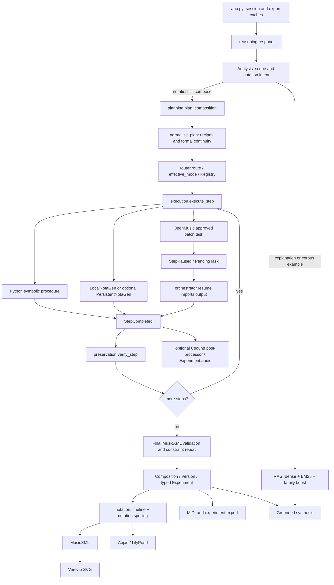

# Composition process architecture

Muschat turns a request into a validated `Plan`, executes symbolic procedures or explicitly selected external
engines, and records immutable `ScoreIR` versions. The language model selects procedures and parameters;
it does not generate executable code. User-facing input and responses support Portuguese and English;
internal schemas and prompts use English. Legacy JSON is migrated at the loading boundary.

## Modules and boundaries

| Module | Responsibility |
|---|---|
| `reasoning` | Scope analysis, conditional retrieval, examples, composition dispatch, final explanation. `Analysis.notation == "compose"` identifies composition intent and skips RAG queries/embeddings. |
| `history` | Configurable recent-message window for analyzer and planner, without deleting stored history. |
| `planning` | Catalog prompt, structured plan, one correction attempt for a missing mandatory engine, bounded safe completion of new Hybrid pieces, recipes and section continuity. |
| `router`, `registry` | Selector precedence, explicit R1-R6 engine rules, detected tools and capabilities. |
| `orchestrator` | Public `compose`, `reapply`, `resume`, `open_score`/`open_musicxml`, `discard`/`discard_task`; sequential pipeline and version recording. |
| `execution` | Uniform `StepCompleted`/`StepPaused` results across Python, NotaGen, and OpenMusic. |
| `preservation` | In-memory structural validation, unique IDs, measures, ties, tuplets, selection diffs and provenance. Intermediate steps do not serialize MusicXML. |
| `composition` | Append-only `Version` history, typed `Experiment`, persisted `PendingTask`, schema restoration after code reload, undo and checkout. |
| `spectrum`, `notation.spelling` | Shared frequency/midicent conversion, quantization, harmonic partials and spectral/written pitch spelling. |
| `dynamics` | Shared per-measure dynamics placement for native and OpenMusic-driven curves. |
| `notation.timeline` | Per-voice/measure gaps, nested tuplet ratios, boundary markers, tie and glissando continuity; both writers consume it independently. |
| `instruments` | Canonical instrument names, aliases, families, clefs and ranges; RAG identification delegates here, retaining macro corpus categories. |
| `openmusic`, `om_patches`, `patches/*.lisp` | Numeric file exchange with approved static patches. Parsers produce scores; they do not launch audio synthesis. |
| `audio` | Optional Csound post-processing and structured audio metadata. |
| `notagen`, `services/notagen_generate.py` | Isolated Python/model environment, bounded generation and optional warm worker. |
| `export` | MIDI, experiment metrics/JSON, packages and explicit format losses. |

## Runtime behavior

Pure composition uses analysis, planning and execution. Explanations and corpus-example requests retain the
hybrid retrieval stage. History passed to analyzer/planner is bounded by `MUSCHAT_HISTORY_MESSAGES`
(default 12, 0 for no prior messages); the SDK chat used for synthesis retains its own conversation history.

OpenMusic remains assisted: a step returns `StepPaused`, the composer runs the task's approved patch and
imports its `saida.txt`, and `resume` validates it before continuing. Python is never reported as OpenMusic.
OMChroma parsing is pure; its completed step supplies an audio callback recorded in `Experiment.audio`.

NotaGen runs in a separate Python environment. It stops at the requested complete synchronized measure rows
(1-16), separates inline ABC voices for MusicXML conversion and normalizes compound notation on import.
The default `LocalNotaGen` loads the model per call. With `MUSCHAT_NOTAGEN_WORKER=1`, `PersistentNotaGen`
keeps weights in a session worker for adjacent requests. JSON-line requests carry condition, measure count,
seed and a temporary output path. Each request resets random seeds. After
`MUSCHAT_NOTAGEN_IDLE_TIMEOUT` seconds without a request (default 60), the worker exits and releases model
memory. A stopped/unavailable worker transparently uses the ordinary subprocess path. Explicit close and
process shutdown also release the worker. The request timeout remains in force.

Capability cache keys include enabled engines, NotaGen paths, OpenMusic/LilyPond/Csound paths and PATH.
The sidebar's manual re-detect action clears session detection/artifact caches. Export caches are bounded
per session and keyed by ScoreIR content hash, transposition mode, engraving tool path and detection revision.

## Verification

Run `uv run pytest -q`. Deterministic reference pieces, spelling, spectral calculations, nested tuplets,
ties/glissandos, engine imports and selection preservation are covered through public interfaces.
Worker contract tests use a lightweight real process rather than requiring neural weights or a GPU.
Actual neural generation and external OpenMusic patch execution are separate integration checks.
